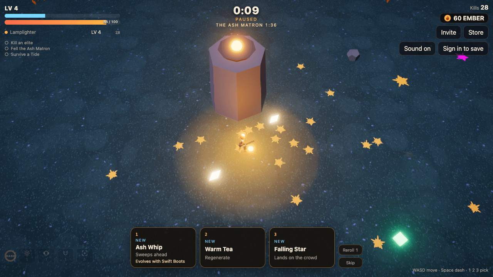

Survivors-like multiplayer browser game template for Net Forge, the open-source multiplayer browser game engine built for AI coding agents.



This is a template for a survivors-like (survivor-like) game that runs in the browser: **EMBERWATCH**, a complete multiplayer game you can start in one command and change in one file. Also searched as survivor-like, horde survival or bullet heaven: weapons fire by themselves, enemies drop XP gems, and every level offers three upgrade cards.

## What you get

- 1 to 4 players in one co-op room, with downed state and revive by standing close.
- A spawn director whose alive cap rises from 20 enemies at the start to 2,000 by minute nine, with elites, two mini-bosses and a final boss.
- Eight weapon kinds (nova, aura, bolt, orbit, cone, chain, meteor, boomerang) with 5 to 8 levels each and evolutions, plus up to 8 passives.
- An authoritative room at 30 Hz with your own keeper predicted in the browser.
- **Authoritative multiplayer.** A room host owns the game state; every browser tab is a player. Locally, `npm run play` runs that host on your computer.
- **Shared client/server simulation.** The same ECS and Rapier physics code steps the world on the server and predicts your own player in the browser, with delta snapshots.
- **three.js renderer with WebGPU**, and a WebGL2 fallback.
- **Bots and a headless playtest.** `npm run test` plays the game with bots and reports what happened.
- **TypeScript, MIT licensed.** The library models, sprites and sounds the game uses are CC0.
- **Ready for coding agents.** `AGENTS.md`, `CLAUDE.md`, Cursor rules, Copilot instructions and the Net Forge MCP server in `.mcp.json`, `.cursor/mcp.json` and `.vscode/mcp.json`.

Measured with `npm run test` (2 bots, 1 minute of game time, Node 22, Apple M2 Pro):

| Playtest report | Value |
|---|---|
| Ticks simulated at 30 Hz | 1,800 |
| Enemies killed | 247 |
| Most enemies alive at once | 93 |
| Highest level reached | 6 |
| Server cost per tick (mean) | under 0.25 ms |
| Softlock | none |

Every number above is play money and a local run. Longer runs: `npm run test -- --minutes 4 --bots 4`.

## Start in one command

```sh
npx create-netforge my-game --template survivor --yes
cd my-game
npm run play
```

Or press **Use this template** on GitHub, clone your new repository, and run:

```sh
npm install && npm run play
```

`npm run play` builds the game, starts a local room and opens http://127.0.0.1:4663. Open the same link in another tab for a second player. WASD or arrows to move, Space to dash, 1 2 3 to pick an upgrade card. On touch, drag on the left half of the screen.

You need Node.js 20 or newer. Use `npm run play -- --no-open` to print the link instead, `--port 4700` if the port is taken, and `--host 0.0.0.0` to let phones on your network join. Local play uses play money: no wallet, no chain and no hosted servers.

## Change the rules

The whole game is `src/game.ts`: declarations against the typed API in `@netforge/engine` (the only import it may make). The template package `@netforge/template-survivor` provides the renderer, netcode, physics, controls, HUD and bots.

```sh
npm run test        # compile src/game.ts and play it with bots; fails on a broken rule or a softlock
npm run typecheck   # the TypeScript check of src/game.ts
npm run play        # play the change (stop and start it again after each edit)
```

The template guide walks through the usual changes:

- [Add an enemy](https://forge.netnet.capital/docs/templates/survivor-like#1-add-an-enemy)
- [Add a weapon and its evolution](https://forge.netnet.capital/docs/templates/survivor-like#2-add-a-weapon-and-its-evolution)
- [Tune the difficulty](https://forge.netnet.capital/docs/templates/survivor-like#3-tune-the-difficulty)
- [Check the change with bots](https://forge.netnet.capital/docs/templates/survivor-like#4-check-the-change-with-bots)

`llms.txt` holds the rules the build enforces and recipes for common changes. Or ask your coding agent in plain words; `AGENTS.md` tells it where the rules live and how to test them.

## Links

- Template guide: https://forge.netnet.capital/docs/templates/survivor-like
- Net Forge engine: https://github.com/netnetdev/net-forge
- Docs: https://forge.netnet.capital/docs
- npm: [create-netforge](https://www.npmjs.com/package/create-netforge), [@netforge/template-survivor](https://www.npmjs.com/package/@netforge/template-survivor), [@netforge/engine](https://www.npmjs.com/package/@netforge/engine)

Pinned to Net Forge 0.2.0. Not affiliated with other projects named NetForge. Local play runs the game's own code on your computer with your permissions; play only games whose code you trust.

## License

MIT ([LICENSE](LICENSE)). The library assets are CC0 1.0.
